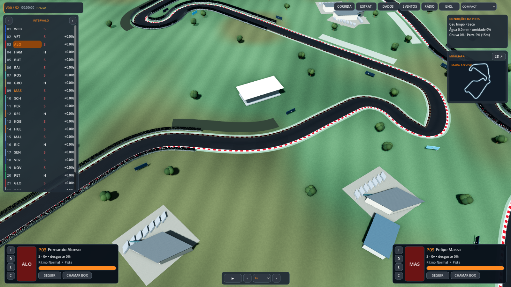

# Comparação da HUD do APEX com jogos de automobilismo

Referência de produto: Core 2 v0.6.6.8.10, commit-base `65b93fa`. Pesquisa e capturas: 21/11/2026. Implementação experimental na branch `feat/hud-manager-reference-20261121`.

O F1 Manager 2024 é a referência mais adequada para a HUD de corrida do APEX: ambos precisam apresentar decisões de dois pilotos simultaneamente. A primeira versão reproduz sua composição e hierarquia com controles e dados do APEX. A identidade visual poderá ser refinada a partir dessa base.

## Escopo da comparação

A pesquisa cobre nove títulos em oito grupos representativos, sem pretender catalogar todos os jogos de automobilismo. O APEX foi executado e capturado nesta rodada; os demais foram estudados por screenshots e documentação pública. A comparação externa é pesquisa de referências, não teste de usabilidade de cada jogo.

| Referência | Organização observada ou documentada | O que aproveitar no APEX |
| --- | --- | --- |
| [F1 Manager 2024](https://store.steampowered.com/app/2591280/F1_Manager_2024/) | Classificação à esquerda, clima e mapa à direita, dois cards inferiores e transporte central. | Estrutura principal, proporções dos cards, agrupamento de métricas e detalhes contextuais. |
| [Motorsport Manager](https://store.steampowered.com/app/415200/Motorsport_Manager/) | Classificação, clima, mapa e painéis de dois pilotos com acesso próximo às decisões de parada. | Relação direta entre condição do carro, estratégia e comando de box. |
| [F1 24](https://www.ea.com/able/resources/f1-24) / [F1 25](https://www.ea.com/able/resources/f1-25) | Documentação de acessibilidade descreve seleção de elementos do HUD; F1 24 também documenta escala/opacidade. | Preservar modos de densidade; priorizar legibilidade e liberdade visual. |
| [Assetto Corsa Competizione](https://support.505games.com/support/solutions/articles/150000146985-assetto-corsa-competizione-pc-1-7-0-patch-notes-2021-feb-10-) | MFD compacto para informações essenciais. | Abrir detalhes técnicos sob demanda, em vez de ocupar permanentemente a pista. |
| [iRacing](https://support.iracing.com/support/solutions/articles/31000167257-black-box-screen-information-and-controls) | Black Boxes separam classificação, proximidade física, combustível e operações de pit. | Distinguir classificação de batalha próxima; deixar claro o significado de cada diferença. |
| [Gran Turismo 7](https://www.gran-turismo.com/us/gt7/manual/race/04) | MFD alterna informações e ajustes, incluindo mapa de combustível. | Poucos controles por contexto, com estado e efeito próximos da ação. |
| [Forza Motorsport](https://forza.net/news/motorsport-community-august-2024) | Radar de proximidade auxilia a consciência situacional. | Futuramente mostrar batalha e ameaça de ultrapassagem; radar de pilotagem não é prioridade do manager. |
| [Automobilista 2](https://forum.reizastudios.com/threads/hud.35216/) | Editor de HUD e níveis light/full documentados por representante da Reiza. | Evolução futura: tamanho e posição configuráveis; manter modos de densidade desde já. |

As aplicações ao APEX são recomendações de design. Elas não implicam que as funcionalidades dos outros jogos já existam no nosso motor.

## Referência principal

[Screenshot oficial de corrida do F1 Manager 2024](https://shared.akamai.steamstatic.com/store_item_assets/steam/apps/2591280/ss_42713640cd41ac03a7dd3c29877227f1a2af4512.1920x1080.jpg?t=1744131889), publicada na galeria Steam da Frontier.

Em 1920×1080, cada card inferior ocupa aproximadamente 32% da largura e 20% da altura. A torre ocupa cerca de 15% da largura. O centro fica livre para acompanhar os carros. Os cards usam uma faixa de identificação, três colunas de métricas e abas de contexto; seleção clara, linhas finas e fundos escuros separam os grupos.

A referência divide os controles em PACE, FUEL e ERS. O APEX trabalha com pneus, ritmo e KERS. O combustível projetado e as temperaturas mecânicas do F1 Manager não devem ser simulados pela interface: só podem aparecer se houver dados correspondentes no motor. KERS e DRS permanecem coerentes com a temporada de 2012.

## Diagnóstico da HUD anterior

Captura real desta rodada, mesma base de código e seed 660 em Silverstone:

1. **Visão geral da corrida — estrutura boa, leitura fragmentada.** Torre, clima, mapa e cards já ficam nas bordas. Porém, os painéis pequenos e isolados têm pesos semelhantes; o card não ajuda a comparar rapidamente pneus, ritmo e energia.
2. **Acompanhamento dos pilotos — informação insuficiente à primeira vista.** A área de retrato mostra um bloco de iniciais quando não há foto. Vida dos pneus é uma barra larga, enquanto temperatura e KERS ficam escondidos. O espaço poderia responder mais perguntas de gestão.
3. **Acesso aos detalhes — descoberta fraca.** As letras T/D/E/C não explicam a função sem tooltip. O jogador precisa aprender abreviações antes de encontrar a estratégia.
4. **Classificação — densidade inadequada para 24 carros.** Na captura de 1600×900, as últimas posições exigem rolagem, embora exista espaço vertical aproveitável. A seleção ocupa só uma parte da linha.
5. **Estado das ordens — ponto forte a preservar.** O código diferencia uma ordem pendente na fila do replay de um agendamento confirmado. Essa distinção e o bloqueio de clique duplicado são essenciais para a confiabilidade de BOX V21.

Riscos de acessibilidade visíveis: textos pequenos em relação ao cenário, abreviações pouco explícitas e uso de cores para identificar pneus/equipes. Letras de composto, posição, rótulos, foco de teclado e mensagens de estado devem complementar as cores. Capturas não comprovam acessibilidade completa, leitura por tecnologia assistiva ou conforto em todos os monitores.

## Implementação e validação

Os resultados finais, arquivos alterados e limites estão no [registro de implementação](HUD_MANAGER_20261121_VALIDACAO.md). As capturas de antes e depois ficam em `qa/hud_manager_20261121/`.

Esta versão é um ponto de partida funcional baseado na referência, não uma cópia pixel a pixel. Tipografia, ícones, dados esportivos e opções disponíveis correspondem ao APEX. Nenhum código, logotipo ou pacote de assets do F1 Manager foi incorporado ao jogo.
