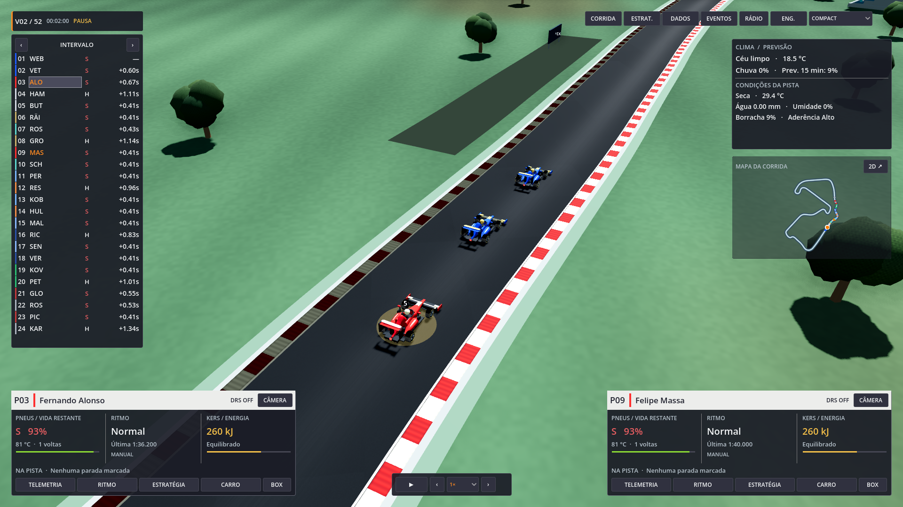
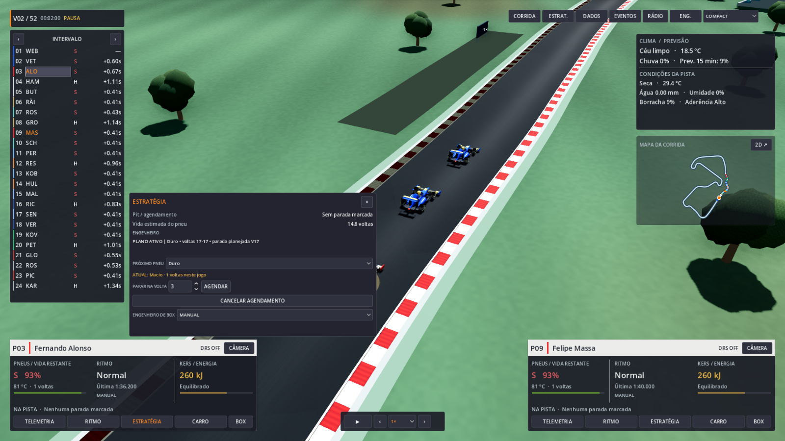
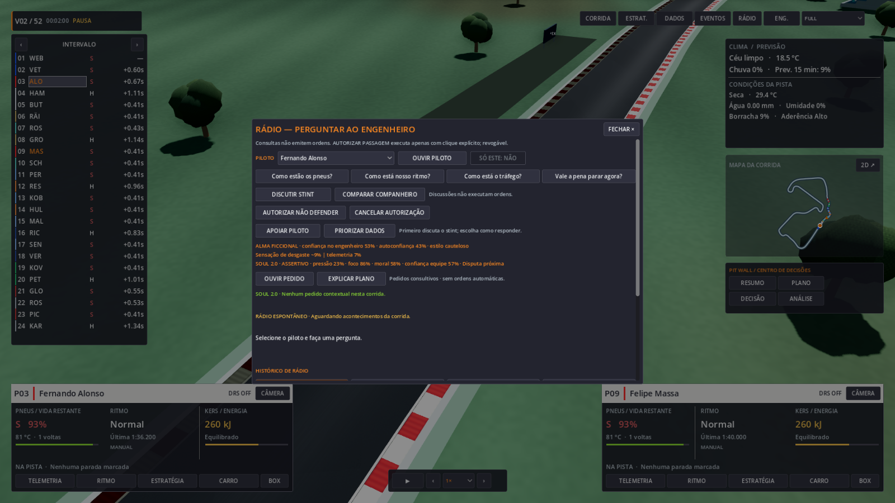

# HUD Manager implementação e validação

Primeira versão funcional inspirada na composição da HUD de corrida do F1 Manager 2024. Base: APEX Core 2 v0.6.6.8.10, commit `65b93fa`. Branch local: `feat/hud-manager-reference-20261121`. A cópia anterior em `apex-security-b108-git` permanece independente.

## Resultado visual



1. **Corrida — PASS.** Torre compacta com 24 pilotos, clima separado das condições da pista, minimapa translúcido e centro livre. Cards com faixa clara, cor da equipe, posição, nome e estado do DRS.
2. **Gestão dos pilotos — PASS.** Três colunas apresentam vida restante e temperatura do pneu, ritmo e última volta, KERS e seu modo. Abas TELEMETRIA, RITMO, ESTRATÉGIA e CARRO substituem T/D/E/C. CÂMERA e BOX usam os callbacks existentes.
3. **Estratégia — PASS.** Os quatro contextos abrem pelo sinal dos botões; os painéis ficam acima dos cards e evitam sobreposição. Ordens pendentes, agendamentos V21 e cancelamentos seguem a fila determinística.
4. **Rádio e modos — PASS.** Janelas existentes preservadas; BROADCAST, COMPACT e FULL continuam disponíveis. FULL mantém os acessos de Pit Wall.





Os controles e dados correspondem ao APEX de 2012: KERS em kJ, pneus e DRS reais do motor. Não há simulação visual de combustível ou de ERS moderno. O trabalho reproduz composição, proporções e agrupamentos; não é uma cópia pixel a pixel nem inclui assets proprietários do F1 Manager.

## Arquivos alterados

| Arquivo | Alteração |
| --- | --- |
| `scripts/apex_race_hud_0622.gd` | Composição, cards, clima, tamanhos, dados existentes e estado textual dos carros. |
| `scripts/apex_race_hud_skin_ui01.gd` | Superfícies grafite, linhas finas, cantos discretos e faixa clara de identificação. |
| `scripts/apex_mini_map.gd` | Opção de fundo transparente. Padrão anterior preservado para os demais consumidores. |
| `tests/hud_manager_20261121_visual.gd` | Capturas reais, abertura de abas, contenção dos painéis e integridade do estado esportivo. |
| `docs/HUD_COMPARATIVO_20261121.md` | Pesquisa de nove títulos, diagnóstico e fontes. |

Motor esportivo, dados de temporada, serialização, regras de replay e física não foram editados. Os relatórios históricos regravados pelos testes foram restaurados; a evidência desta rodada está em `qa/hud_manager_20261121`.

## Verificação executada

| Verificação | Resultado | Evidência |
| --- | --- | --- |
| Importação Godot 4.7.2 | PASS | `logs/import-after.log`, saída 0, sem erro de script/recurso. |
| 14 regressões do CI | PASS | Ordens de equipe, rádio, Driver Dynamics, Racecraft, classificação, double stack, replay e modelo 3D. |
| 8 verificações HUD | PASS | Modos, integração, fila de pit, isolamento replay, câmeras, restart, widgets legados e cenários. |
| Salvamento/carregamento | PASS | Migração e preservação de carreira/garagem. |
| GdUnit4 | PASS | 2 casos executados, 0 falhas, erros, ignorados ou órfãos. |
| Rechecks após ajustes finais | PASS | 6 testes de HUD/UI repetidos na revisão final. |
| Captura visual e interação | PASS | 8 PNGs, 4 contextos por resolução e verificação de sobreposição; hash esportivo preservado. |
| Capturas com fixture original | PASS | 2D BROADCAST, 2D COMPACT, 3D COMPACT, mesma seed/cena de antes. |
| FPS e comparação de desempenho | NOT_RUN | Não se declara ganho de desempenho. |
| GPs completos e temporadas longas | NOT_RUN | Cenários desta rodada completaram três voltas em quatro pistas. |

Total automatizado: **24/24 verificações existentes**, incluindo a suíte GdUnit4; captura visual verificada separadamente. A primeira invocação do GdUnit4 apenas mostrou ajuda: foi corrigida e repetida, com a tentativa anterior preservada no relatório, sem contar como teste aprovado.

Relatórios: [testes](../qa/hud_manager_20261121/tests.json) e [manifesto das capturas](../qa/hud_manager_20261121/after/manifest.json).

As imagens finais têm 1600×900 e 1920×1080 pixels. Na janela solicitada de 1366×768, o canvas 16:9 produz uma área renderizada de **1365×768**; o manifesto registra o tamanho real, sem redimensionar a captura. Textos secundários ficam menores nessa resolução devido à escala já usada pelo projeto. Acessibilidade completa e navegação integral por teclado não foram certificadas.

## Abrir a cópia e voltar à anterior

Abra o `project.godot` de `apex-hud-manager-20261121` no Godot 4.7.2 e inicie uma corrida. Para esta máquina, a partir da pasta dessa cópia:

```bash
GODOT_BIN=/home/jugdru/Downloads/Godot_v4.7.2-stable_linux.x86_64 sh linux/run_apex.sh
```

Para voltar ao visual anterior, abra o projeto em `apex-security-b108-git`. Esta entrega não substitui executáveis/ZIPs distribuídos e não foi publicada no GitHub.
